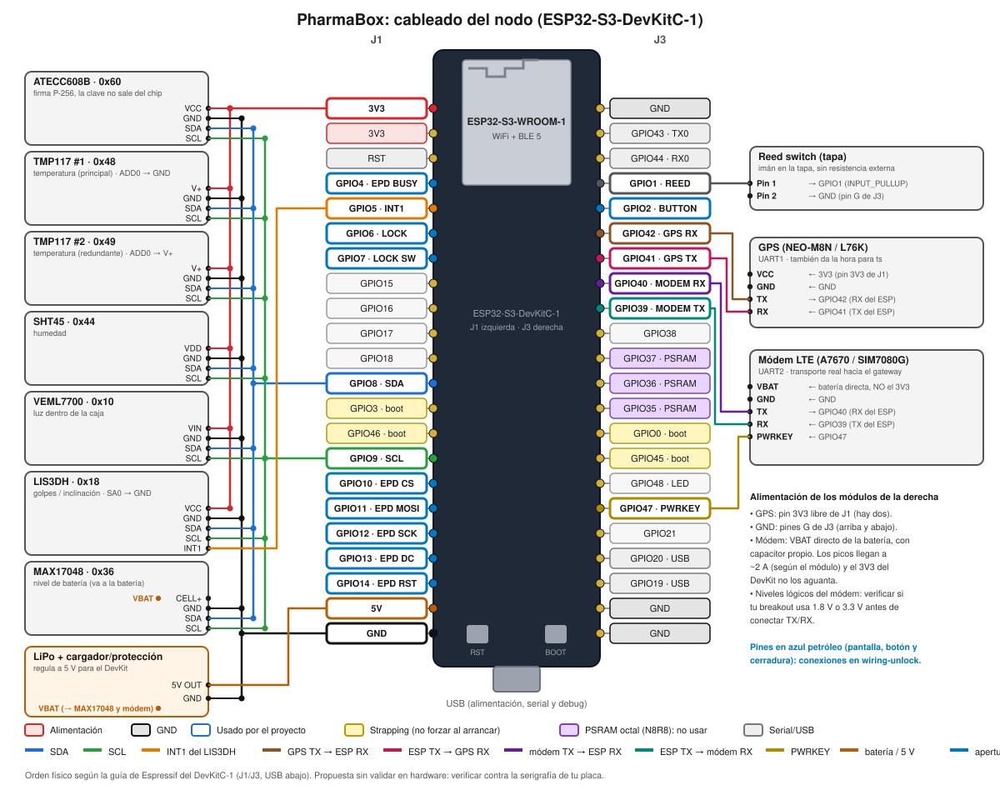
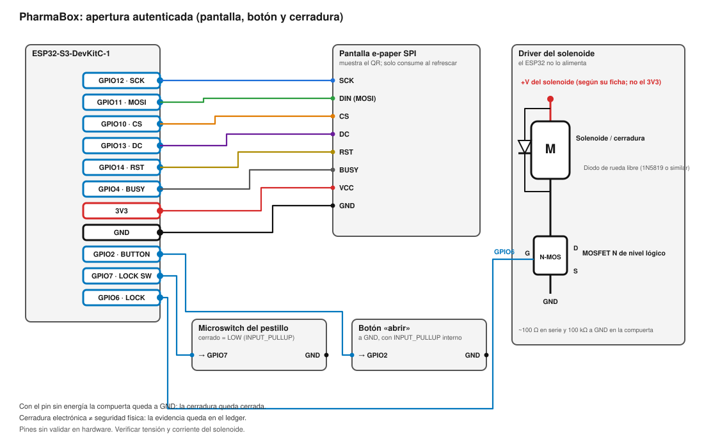

[English](README.md) · **Español**

# pharmatrace-firmware

Firmware del nodo de la **PharmaBox** (la valija de cadena de frío que custodia los lotes de
[Pharmatrace](https://github.com/gastonhp1/Pharmatrace)). Mide el estado del cargamento durante el transporte,
**firma cada lectura** con un secure element y la sube al gateway de Pharmatrace, que la verifica y ancla
evidencia en el ledger de Hyperledger Fabric.

El nodo no habla con Fabric: solo con el gateway (`backend/` de Pharmatrace). Ver [`docs/architecture.md`](docs/architecture.md).

## Estado

Esqueleto. Esto es lo que está verificado y lo que no:

| | Estado |
|---|---|
| Formato de lectura v1 (21 bytes), conversión de unidades, armado del JSON de ingesta, cola de lecturas | **Probado en la PC**: 17 tests, el vector oficial de `READING_FORMAT.md`, 5000 lecturas aleatorias contra una implementación independiente en Python y el código real de `ingest.js` del gateway aceptando el JSON que arma este firmware |
| `src/main.cpp`, `uplink_wifi.cpp` (Arduino/ESP32) | Escrito, **no compilado ni probado en hardware** |
| Apertura autenticada, opción A (token por BLE): validación del token, nonce/QR, bloqueo por intentos | **Probado en la PC**: 14 tests, más corridas de punta a punta donde Python firma un token y el código C++ lo verifica con el mismo código mbedtls P-256 que usa el ESP32 (válido, otra clave, otra caja, otro nonce, token alterado) |
| Servicio BLE, e-paper, cerradura y botón (`ble_unlock`, `lock`, `display`, `main.cpp`) | Escrito, **solo revisado de sintaxis contra stubs; no compilado con las librerías reales ni probado en hardware**. La e-paper es por ahora una salida por serie |
| Drivers de sensores, módem celular | TODO (`main.cpp` los marca) |
| Firma con el ATECC608B | TODO: `signer_atecc608.cpp` falla a propósito en vez de devolver una firma falsa |
| Pines y cableado | Propuesta sin validar en hardware |

## Contrato con el gateway

Se define en [`iot/docs/READING_FORMAT.md`](https://github.com/gastonhp1/Pharmatrace/blob/main/iot/docs/READING_FORMAT.md) de Pharmatrace. Si cambia ahí, cambia acá.

- Una lectura son **21 bytes, big-endian**: `ts`, `seq`, `tempCenti`, `humCenti`, `flags`, `latE5`, `lonE5`.
- El dispositivo firma **SHA-256(payload)** con **ECDSA P-256**, firma cruda `r || s` de 64 bytes (lo que hace el ATECC608B).
- Se sube con `POST /api/iot/readings` `{ deviceId, readings: [{ payload, signature }] }` en hex. No lleva clave de API: el gateway acepta solo firmas válidas de un dispositivo registrado y con monitoreo activo.

Lo que el gateway exige y el firmware respeta:

- `seq` y `ts` **estrictamente crecientes** dentro del cargamento. El `seq` se reserva y persiste en NVS *antes* de usarlo.
- Máximo **200 lecturas por request** (`UPLOAD_BATCH_MAX` = 50).
- Responde `200 { accepted, duplicates, rejected }`. Un duplicado exacto no es error, así que **reintentar un lote es seguro**.
- `409` si la valija todavía no monitorea ningún cargamento, `403` si no está operativa: en ambos casos las lecturas se conservan.
- `SAMPLE_INTERVAL_S` (60) tiene que coincidir con `IOT_SAMPLE_SECONDS` del gateway, que cuenta la última lectura de cada ventana como un período de muestreo.

El firmware **no juzga** si una temperatura está en rango: la política (2–8 °C, presupuesto de excursión) vive en el ledger y la aplica el chaincode.

## Hardware

Según [`iot/hardware/BOM.md`](https://github.com/gastonhp1/Pharmatrace/blob/main/iot/hardware/BOM.md) de Pharmatrace: **ESP32-S3** (no la ESP32 clásica), 2 × TMP117, SHT45, VEML7700, LIS3DH, **ATECC608B**, MAX17048, GPS, módem LTE (A7670 o SIM7080G) reed switch de tapa y, para la apertura autenticada, una pantalla e-paper SPI, un botón y una cerradura de solenoide (ver [`docs/unlock-protocol.md`](docs/unlock-protocol.md)).

## Cableado



Pantalla, botón y cerradura (pines en azul petróleo) en detalle:



Pines en [`include/config.h`](include/config.h), en la numeración del ESP32-S3-DevKitC-1:

| Función | GPIO | Va a |
|---|---|---|
| I2C SDA / SCL | 8 / 9 | TMP117 ×2, SHT45, VEML7700, LIS3DH, ATECC608B, MAX17048 |
| INT1 (golpe) | 5 | LIS3DH |
| Reed de la tapa | 1 | Reed switch a GND, con `INPUT_PULLUP` |
| UART1 GPS | 42 (RX) / 41 (TX) | TX / RX del GPS |
| UART2 módem | 40 (RX) / 39 (TX) | TX / RX del módem |
| PWRKEY del módem | 47 | Módem |
| SPI de la e-paper (SCK / MOSI / CS / DC / RST / BUSY) | 12 / 11 / 10 / 13 / 14 / 4 | Pantalla que muestra el QR de apertura |
| Botón «abrir» | 2 | Botón a GND, con `INPUT_PULLUP` |
| Cerradura (comando / sensor de pestillo) | 6 / 7 | Compuerta del MOSFET del solenoide / microswitch del pestillo |

Cosas a tener en cuenta:

- **El módem no se alimenta del 3V3 del DevKit.** Toma la corriente de la batería con su propio capacitor: los picos llegan a ~2 A según el módulo.
- Verificar si el breakout del módem usa niveles lógicos de 1.8 V o 3.3 V.
- Con módulos de PSRAM octal (N8R8) los GPIO35–37 no están disponibles; este mapa no los usa. GPIO0/3/45/46 son de strapping y GPIO19/20 son el USB.
- GPIO39–42 son los pines de JTAG por pines; sirven como GPIO mientras se depure por el USB nativo.
- GPIO1 y GPIO5 son GPIO RTC: pueden despertar al equipo de deep sleep.
- El orden de pines sale de la guía de Espressif del DevKitC-1. Verificalo contra la serigrafía de tu placa antes de soldar.
- Direcciones I2C: el TMP117 #1 usa `ADD0 → GND` (0x48) y el #2 `ADD0 → V+` (0x49); el LIS3DH usa `SA0 → GND` (0x18). El MAX17048 se alimenta de la batería, no del 3V3.

## Estructura

```
include/config.h               Pines, intervalos y tamaños
include/secrets.example.h      Plantilla de DEVICE_ID, gateway y WiFi (secrets.h no se versiona)
lib/pharma_proto/              Protocolo sin Arduino (se prueba en la PC)
  pharma_reading.*               Formato de 21 bytes, conversiones, hex
  pharma_ingest.*                Cuerpo de POST /api/iot/readings
  pharma_queue.h                 Cola de lecturas firmadas pendientes
  pharma_unlock.*                Token de apertura, texto del QR, sesión de desafío e intentos
src/main.cpp                   Ciclo: sensar → firmar → encolar → subir
src/signer*.{h,cpp}            Interfaz de firma + esqueleto del ATECC608B
src/verifier_mbedtls.*         Verificación P-256 del token de apertura
src/ble_unlock.*, lock.*, display*   Servicio BLE, cerradura de solenoide, pantalla (stub por serie)
tools/unlock_token.py          Genera una clave de prueba y firma tokens de apertura
src/uplink*.{h,cpp}            Interfaz de transporte + WiFi para pruebas de banco
test/test_proto/               Tests del protocolo, incluido el vector oficial
test/test_unlock/              Tests del token y la sesión de apertura
tools/e2e_unlock.cpp           Programa de la PC: verifica un token firmado con tools/unlock_token.py
docs/unlock-protocol.md        Protocolo de apertura autenticada
docs/architecture.md           Cómo encaja con el gateway y Fabric
docs/wiring.{es,en}.svg        Diagrama de cableado (español e inglés)
```

## Tests y build

```bash
pip install platformio
pio test -e native              # protocolo, en la PC (sin hardware)

cp include/secrets.example.h include/secrets.h    # completar DEVICE_ID, GATEWAY_URL, WiFi
cp include/unlock_key.example.h include/unlock_key.h   # clave PÚBLICA de apertura del backend
pio run                         # compilar para ESP32-S3
pio run -t upload && pio device monitor
```

Para probar el gateway sin hardware, Pharmatrace trae un simulador de valija en `iot/simulator/` que genera
lecturas firmadas con el mismo formato.

## Pendiente

- **ATECC608B:** aprovisionar (clave P-256 generada en el chip, solo se lee la pública, bloquear configuración y datos) e implementar `Atecc608Signer`. La pública que imprime el arranque es la que se registra con `POST /api/iot/devices`.
- **Secure boot y flash encryption** del ESP32-S3 antes de entregar una valija.
- **Drivers** de TMP117, SHT45, LIS3DH, VEML7700, MAX17048, GPS y el módem (con TLS).
- **Persistir la cola en flash** (LittleFS): hoy está en RAM y se pierde al reiniciar. Si se llena, descarta la más vieja y queda un hueco de `seq`.
- **Deep sleep** con despertar por reed y acelerómetro, para la autonomía.
- **Dos formas de que el formato v1 se quede corto** (hay que cambiarlo en los tres repos a la vez):
  - Tiene un solo campo de temperatura, pero el BOM trae dos TMP117 para detectar fallas o manipulación. Falta decidir qué se reporta y cómo se marca el desacuerdo (los bits 5–7 de `flags` están libres; 0x08 y 0x10 se proponen para eventos de apertura).
  - No hay un bit de "fix de GPS válido": sin fix se reutiliza la última posición conocida.
- **Hora:** sin hora válida (GPS o RTC sincronizado) no se emite nada.

## Relación con Pharmatrace

[Pharmatrace](https://github.com/gastonhp1/Pharmatrace) es ahora la versión sobre **Hyperledger Fabric**: chaincode en Go, red local de 4 organizaciones, API Express sobre Fabric Gateway y la carpeta `iot/`. La versión Solidity/Hardhat quedó en [Pharmatrace-evm](https://github.com/gastonhp1/Pharmatrace-evm). Este repo es aparte porque el ciclo de build, flasheo y versionado del firmware es independiente.
