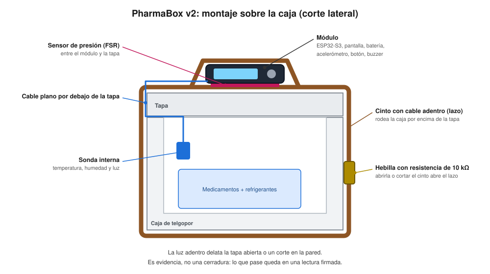
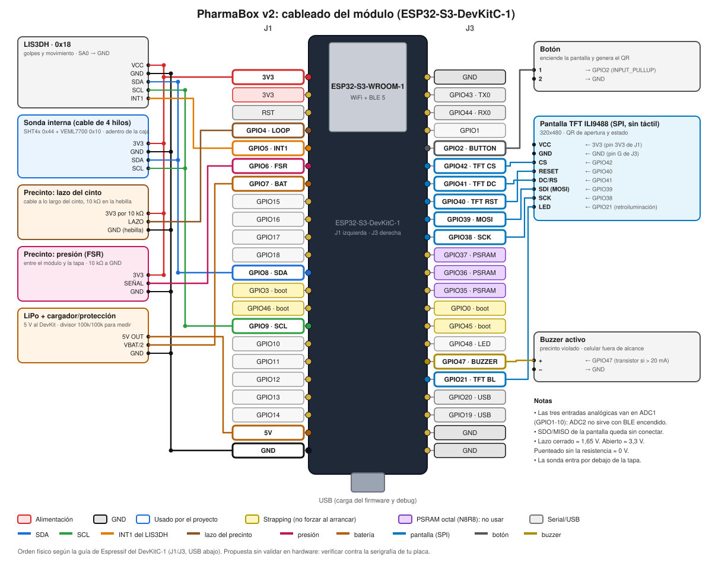

[English](README.md) · **Español**

# pharmatrace-firmware

Firmware de la **PharmaBox**: un módulo que va sobre la tapa de una caja de telgopor para medicamentos, sujeto por un
cinto que funciona como precinto. Mide temperatura y humedad adentro de la caja, vigila el precinto, **firma cada
lectura** y se la pasa por Bluetooth a un celular, que la sube al gateway de
[Pharmatrace](https://github.com/gastonhp1/Pharmatrace). El gateway verifica cada firma y ancla la evidencia en el
ledger de Hyperledger Fabric.

La caja no habla con nada más que un celular. Ver [`docs/architecture.md`](docs/architecture.md).



## Qué cambió en la v2

El primer diseño era una valija autónoma: GPS, módem LTE, elemento seguro, cerradura de solenoide, e-paper. La v2
es un aparato chico que se apoya en el celular:

| | v1 | v2 |
|---|---|---|
| Subida | Módem LTE | El celular vinculado releva las lecturas firmadas |
| Posición y hora | GPS | Las manda el celular; la hora también sale de los tokens de apertura firmados |
| Clave de firma | Elemento seguro ATECC608B | ECDSA por software, clave en la flash del ESP32 |
| Apertura | Cerradura de solenoide | Precinto de cinto: un token válido habilita romperlo |
| Pantalla | e-paper | TFT ILI9488 (320x480, SPI, sin táctil) |
| Sensores | 2 × TMP117, SHT45, VEML7700, reed switch | SHT4x + VEML7700 en una sonda adentro de la caja |

Lo que se resigna, dicho claro:

- **La clave se puede extraer** teniendo la placa en la mano, y con ella fabricar lecturas. Hay que activar flash
  encryption y secure boot antes de entregar una caja. Está bien para un prototipo; un producto regulado debería
  volver a un elemento seguro.
- **La posición es la que diga el celular.** La caja la firma pero no la puede comprobar.
- **Sin celular no hay subida.** Las lecturas esperan en RAM (512, unas 8,5 horas).
- **Después de un reinicio no hay hora** hasta que la ponga un celular o un token de apertura, y sin hora no se
  emite nada.

## Estado

| | Estado |
|---|---|
| Formato de lectura v1, conversión de unidades, JSON de ingesta, cola | **Probado en la PC** (17 tests, vector oficial de `READING_FORMAT.md`) |
| Token de apertura y sesión de desafío | **Probado en la PC** (14 tests) |
| Máquina de estados del precinto, reloj sin GPS, CRC y conversión del SHT4x | **Probado en la PC** (19 tests) |
| Firmador por software y verificador del token (mbedtls P-256) | **Probado en la PC** contra Python y contra el **código real del gateway** (`backend/iot/ingest.js`): acepta las lecturas, marca el precinto violado y rechaza una firma alterada. Se corre con `tools/host_check.sh` |
| Todo lo de Arduino/ESP32: `main.cpp`, BLE, pantalla, I2C de sensores, ADC | Escrito contra hojas de datos y documentación de las librerías, **solo revisado de sintaxis contra stubs. No compilado con las librerías reales ni probado en hardware** |
| Lado del celular del relevo (`docs/companion-protocol.md`) | **Ninguna app lo implementa todavía.** PharmaTrace-mobile solo abre la caja |
| Pines y cableado | Propuesta, sin validar en hardware |

## Hardware

- **ESP32-S3** (DevKitC-1)
- TFT **ILI9488**, 320x480, SPI, sin táctil
- **Sonda interna** con cable plano de 4 hilos: **SHT4x** (temperatura y humedad) y **VEML7700** (luz)
- Acelerómetro **LIS3DH**
- **Precinto de cinto**: un cable a lo largo del cinto que cierra a través de una resistencia de 10 kΩ en la
  hebilla, y un sensor de fuerza resistivo (FSR) debajo del módulo
- Batería LiPo con cargador/protección, un botón y un buzzer activo
- Resistencias: 3 × 10 kΩ, 2 × 100 kΩ

Sin GPS, módem, elemento seguro, cerradura ni medidor de batería.

## Cableado



Los pines están en [`include/config.h`](include/config.h), con la numeración del ESP32-S3-DevKitC-1:

| Función | GPIO | Va a |
|---|---|---|
| I2C SDA / SCL | 8 / 9 | LIS3DH en el módulo; SHT4x y VEML7700 en la sonda |
| INT1 (golpe) | 5 | LIS3DH |
| Lazo del precinto | 4 (ADC) | 3V3 – 10 kΩ – **pin** – cable del cinto – 10 kΩ en la hebilla – GND |
| Presión del precinto | 6 (ADC) | 3V3 – FSR – **pin** – 10 kΩ – GND |
| Batería | 7 (ADC) | VBAT – 100 kΩ – **pin** – 100 kΩ – GND |
| TFT CS / DC / RST / MOSI / SCK | 42 / 41 / 40 / 39 / 38 | ILI9488 (su SDO/MISO queda sin conectar) |
| Retroiluminación del TFT | 21 | LED del ILI9488 |
| Botón | 2 | Botón a GND, `INPUT_PULLUP` |
| Buzzer | 47 | Buzzer activo (con transistor si pasa de ~20 mA) |

Cosas a tener en cuenta:

- Las entradas analógicas tienen que ir en ADC1 (GPIO1–10): ADC2 no funciona con la radio encendida.
- El lazo da unos 1,65 V cerrado, 3,3 V abierto o cortado y 0 V si alguien puentea la hebilla con un cable. Un
  puente sobre un tramo del cinto que no incluye la resistencia **no** se detecta así; para eso están el sensor
  de presión y el de luz.
- Los umbrales del precinto (`SealConfig` en `pharma_seal.h`) son estimados. Un «precinto violado» falso deja un
  cargamento `COMPROMISED`, así que hay que calibrarlos con la caja real antes de confiar.
- Adentro de una caja fría la humedad es alta: usar un SHT4x con filtro de membrana y barnizar la plaquita.
- La retroiluminación consume 40–80 mA, por eso la pantalla se apaga sola a los 30 s.
- GPIO39–42 son los pines de JTAG por pines; sirven como GPIO normales mientras se depure por el USB nativo del S3.
  GPIO0/3/45/46 son de strapping, GPIO19/20 son el USB y GPIO35–37 no están en módulos con PSRAM octal.
- El orden de los pines sale de la guía de usuario de Espressif del DevKitC-1. Verificar contra la serigrafía de tu
  placa antes de soldar.

Los diagramas se generan: `python3 tools/gen_wiring.py es docs/wiring.es.svg` y `tools/gen_box.py`.

## Cómo funciona

**Lecturas.** Cada 60 s la caja lee la sonda, arma la lectura de 21 bytes de
[`READING_FORMAT.md`](https://github.com/gastonhp1/Pharmatrace/blob/main/iot/docs/READING_FORMAT.md), firma
SHA-256(payload) con ECDSA P-256 (`r || s` crudo) y la encola. Ese contrato no cambió, así que el gateway no
necesita cambios. `seq` y `ts` son estrictamente crecientes; `seq` se persiste antes de usarse.

**Precinto.** Tres señales dicen que la caja sigue cerrada: el lazo del cinto, la presión debajo del módulo y la
sonda (presente y a oscuras). Si alguna falla sin permiso, la caja queda en «precinto violado», que sale como
`SEAL_BROKEN` en cada lectura hasta una apertura válida. La luz adentro además levanta `LID_OPENED`.

**Apertura.** Se aprieta el botón: la pantalla muestra un QR con un nonce de un solo uso. La app se lo manda al
backend, que decide si ese usuario puede abrir y firma un token corto. La app escribe el token por BLE; la caja lo
verifica sin internet y habilita abrir el precinto durante 10 minutos sin que cuente como violación. Al cerrarlo
se vuelve a armar. Protocolo en [`docs/unlock-protocol.md`](docs/unlock-protocol.md).

**Celular.** Un celular vinculado con el PIN de 6 dígitos de la pantalla pone hora y posición, recibe las lecturas
firmadas y las sube, y la caja le avisa si se aleja. Contrato en
[`docs/companion-protocol.md`](docs/companion-protocol.md).

## Estructura

```
include/config.h               Pines, intervalos y tamaños
include/secrets.example.h      Plantilla de DEVICE_ID y WiFi de banco (secrets.h no se versiona)
include/unlock_key.example.h   Plantilla de la clave pública de apertura del backend
lib/pharma_proto/              Lógica sin dependencias de Arduino (probada en la PC)
  pharma_reading.*               Formato de 21 bytes, conversiones, hex
  pharma_ingest.*                Cuerpo de POST /api/iot/readings
  pharma_queue.h                 Cola de lecturas firmadas pendientes
  pharma_unlock.*                Token de apertura, texto del QR, sesión de desafío e intentos
  pharma_seal.*                  Máquina de estados del precinto
  pharma_clock.h                 Reloj sin GPS ni RTC
  pharma_sht4x.*                 CRC y conversión del SHT4x
src/main.cpp                   Loop: precinto, apertura, celular, muestrear → firmar → encolar
src/p256_soft.*, signer*       ECDSA P-256 por software (mbedtls), clave en NVS
src/verifier_mbedtls.*         Verificación P-256 del token de apertura
src/ble_box.*                  BLE: servicio de apertura y servicio del celular vinculado
src/sensors.*                  SHT4x, VEML7700 y LIS3DH por I2C; lazo, FSR y batería por ADC
src/display*                   ILI9488 con LovyanGFX, o salida por serie sin la librería
src/uplink*                    Subida directa por WiFi, solo banco (-DBENCH_WIFI_UPLINK)
test/                          Tests en la PC: test_proto, test_unlock, test_seal
tools/host_check.sh            Comprobaciones que necesitan mbedtls, Python y el backend de Pharmatrace
tools/unlock_token.py          Genera una clave de prueba y firma tokens de apertura
tools/gen_wiring.py, gen_box.py  Generan los diagramas
docs/                          Arquitectura, protocolo de apertura, protocolo del celular, diagramas
```

## Tests y build

```bash
pip install platformio
pio test -e native              # lógica, en la PC (sin hardware)

sudo apt install g++ libmbedtls-dev && pip install cryptography
tools/host_check.sh ../Pharmatrace/backend     # firmador, verificador del token, código real del gateway

cp include/secrets.example.h include/secrets.h        # DEVICE_ID
cp include/unlock_key.example.h include/unlock_key.h  # clave PÚBLICA de apertura del backend
                                                      # (la imprime `node scripts/unlock-key.js generate`)
pio run                         # compilar para ESP32-S3
pio run -t upload && pio device monitor
```

Al arrancar, la caja imprime su clave pública: hay que registrarla con `POST /api/iot/devices`. Para probar una
apertura sin la app, pegar el token de `tools/unlock_token.py` en la característica `unlock` con nRF Connect.

## Pendiente

- **Compilar y probar en hardware.** Nada del código de ESP32 se compiló con las librerías reales.
- **Lado de la app del relevo**: vinculación, hora y posición, subida de lecturas.
- **Calibrar los umbrales del precinto** con una caja real, y decidir si el sensor de presión justifica sus falsos
  positivos.
- **Flash encryption y secure boot**, porque la clave ahora vive en la flash.
- **Persistir la cola en flash** (LittleFS): vive en RAM y se pierde al reiniciar.
- **Deep sleep** entre muestras, despertando con el botón y el acelerómetro. Hoy el loop nunca duerme.
- **RTC** (DS3231 o similar) para mantener la hora entre reinicios.
- **El formato v1 se queda corto** en dos cosas que exigen cambiar todos los repos a la vez: no puede decir «sin
  dato de temperatura» ni «posición del celular / sin posición».
- **Bloqueo por un tercero**: tres tokens inválidos de cualquiera en alcance de BLE bloquean el QR hasta volver a
  apretar el botón (ver `docs/unlock-protocol.md`).

## Relación con Pharmatrace

| Repo | Rol para la PharmaBox |
|---|---|
| [Pharmatrace](https://github.com/gastonhp1/Pharmatrace) | Red y chaincode de Hyperledger Fabric, el gateway que verifica y ancla las lecturas (`/api/iot`) y el backend de apertura (`/api/box`). Su `iot/hardware/BOM.md` y su `iot/docs/BOX_UNLOCK.md` todavía describen el hardware v1 |
| [PharmaTrace-mobile](https://github.com/gastonhp1/PharmaTrace-mobile) | App Android: escanea el QR, le pide un token al backend y lo escribe por BLE. Sus UUIDs, códigos de resultado y tamaño de token coinciden con este firmware. Todavía no implementa el relevo |
| [PharmaTrace-UI](https://github.com/gastonhp1/PharmaTrace-UI) | UI web sobre la misma API REST. No habla con la caja |
| [Pharmatrace-evm](https://github.com/gastonhp1/Pharmatrace-evm) | La versión anterior en Solidity/Hardhat |

Última verificación cruzada con estos repos: 2026-11-15.
