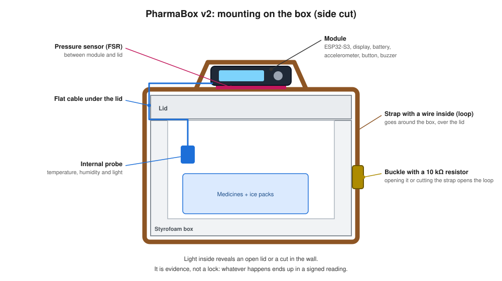
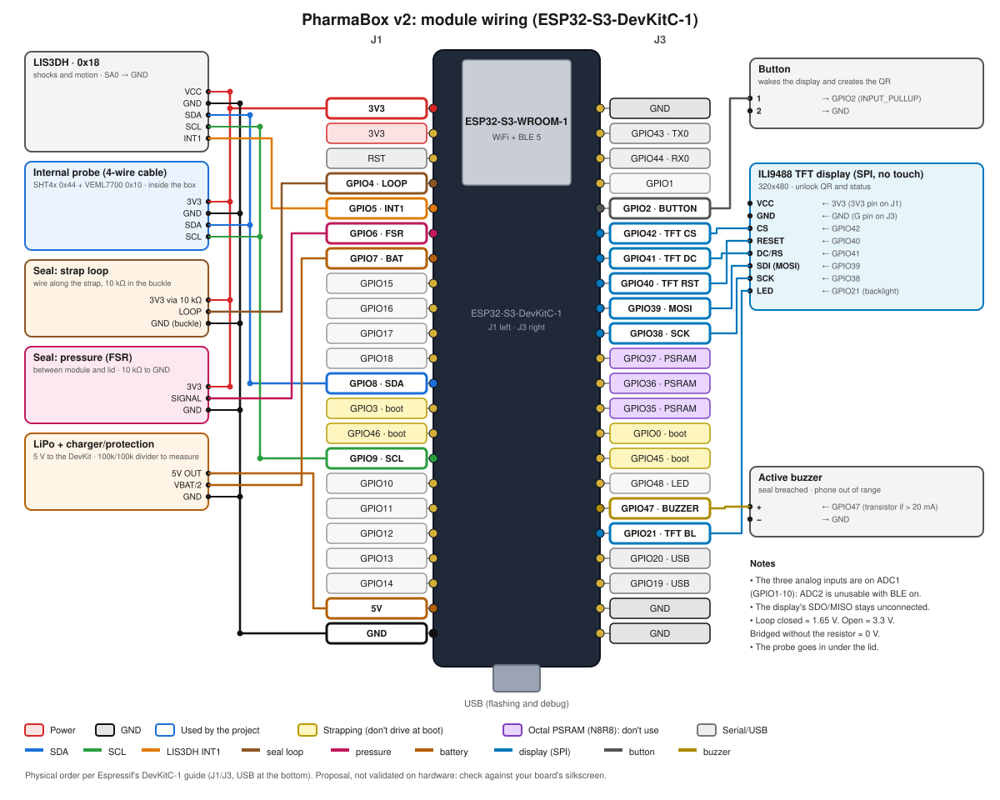

**English** · [Español](README.es.md)

# pharmatrace-firmware

Firmware for the **PharmaBox**: a module that sits on the lid of a styrofoam medicine box, held by a strap that works
as a tamper seal. It measures temperature and humidity inside the box, watches the seal, **signs every reading** and
hands it over Bluetooth to a phone, which uploads it to the [Pharmatrace](https://github.com/gastonhp1/Pharmatrace)
gateway. The gateway verifies each signature and anchors evidence in the Hyperledger Fabric ledger.

The box talks to nothing but a phone. See [`docs/architecture.md`](docs/architecture.md) (in Spanish).



## What changed in v2

The first design was a self-contained case: GPS, LTE modem, secure element, solenoid lock, e-paper. v2 is a small
gadget that leans on the phone:

| | v1 | v2 |
|---|---|---|
| Uplink | LTE modem | The paired phone relays signed readings |
| Position and time | GPS | Sent by the phone; time also from signed unlock tokens |
| Signing key | ATECC608B secure element | Software ECDSA, key in the ESP32's flash |
| Opening | Solenoid lock | Strap seal: a valid token allows breaking the seal |
| Display | e-paper | ILI9488 TFT (320x480, SPI, no touch) |
| Sensors | 2 × TMP117, SHT45, VEML7700, reed switch | SHT4x + VEML7700 on a probe inside the box |

What this gives up, stated plainly:

- **The key can be extracted** by someone holding the board, who could then forge readings. Enable flash encryption
  and secure boot before handing a box over. Fine for a prototype; a regulated product should go back to a secure
  element.
- **The position is whatever the phone says.** The box signs it but cannot check it.
- **No phone, no upload.** Readings wait in RAM (512, about 8.5 hours).
- **No time after a reboot** until a phone or an unlock token provides it, and without time nothing is emitted.

## Status

| | Status |
|---|---|
| Reading format v1, unit conversion, ingest JSON, queue | **Tested on the host** (17 tests, official vector from `READING_FORMAT.md`) |
| Unlock token and challenge session | **Tested on the host** (14 tests) |
| Strap seal state machine, clock without GPS, SHT4x CRC and conversion | **Tested on the host** (19 tests) |
| Software signer and token verifier (mbedtls P-256) | **Tested on the host** against Python and against the **real gateway code** (`backend/iot/ingest.js`): it accepts the readings, flags the broken seal and rejects a tampered signature. Run `tools/host_check.sh` |
| Everything Arduino/ESP32: `main.cpp`, BLE, display, sensor I2C, ADC | Written against datasheets and library docs, **only syntax-checked against stubs. Not compiled with the real libraries, not tested on hardware** |
| Phone side of the relay (`docs/companion-protocol.md`) | **No app implements it yet.** PharmaTrace-mobile only opens the box |
| Pins and wiring | Proposal, not validated on hardware |

## Hardware

- **ESP32-S3** (DevKitC-1)
- **ILI9488** TFT, 320x480, SPI, no touch
- **Internal probe** on a flat 4-wire cable: **SHT4x** (temperature and humidity) and **VEML7700** (light)
- **LIS3DH** accelerometer
- **Strap seal**: a wire along the strap closing through a 10 kΩ resistor in the buckle, and a force-sensitive
  resistor (FSR) under the module
- LiPo battery with charger/protection, a button and an active buzzer
- Resistors: 3 × 10 kΩ, 2 × 100 kΩ

The pressure sensor is off by default (`SEAL_USE_FSR` in `config.h`): it is the part most prone to false alarms.

No GPS, modem, secure element, lock or fuel gauge.

## Wiring



Pins are in [`include/config.h`](include/config.h), using ESP32-S3-DevKitC-1 numbering:

| Function | GPIO | Connects to |
|---|---|---|
| I2C SDA / SCL | 8 / 9 | LIS3DH on the module; SHT4x and VEML7700 on the probe |
| INT1 (shock) | 5 | LIS3DH |
| Seal loop | 4 (ADC) | 3V3 – 10 kΩ – **pin** – strap wire – 10 kΩ in the buckle – GND |
| Seal pressure | 6 (ADC) | 3V3 – FSR – **pin** – 10 kΩ – GND |
| Battery | 7 (ADC) | VBAT – 100 kΩ – **pin** – 100 kΩ – GND |
| TFT CS / DC / RST / MOSI / SCK | 42 / 41 / 40 / 39 / 38 | ILI9488 (its SDO/MISO stays unconnected) |
| TFT backlight | 21 | ILI9488 LED |
| Button | 2 | Button to GND, `INPUT_PULLUP` |
| Buzzer | 47 | Active buzzer (through a transistor above ~20 mA) |

Things to keep in mind:

- The analog inputs must be on ADC1 (GPIO1–10): ADC2 does not work while the radio is on.
- The loop reads about 1.65 V closed, 3.3 V open or cut, and 0 V if someone bridges the buckle with a plain wire.
  A jumper across a stretch of strap that does not include the resistor is **not** detectable this way; the pressure
  sensor and the light sensor are there for that.
- The seal thresholds (`SealConfig` in `pharma_seal.h`) are guesses. A false "seal broken" marks a cargo as
  `COMPROMISED`, so calibrate them on the real box before trusting them.
- Inside a cold box humidity is high: use an SHT4x with a membrane filter and coat the probe board.
- The backlight draws 40–80 mA, so the display turns itself off after 30 s. That is more than a GPIO should
  source: unless your module has a transistor on its LED pin, drive it through one.
- GPIO39–42 are the pin-based JTAG pins; they work as plain GPIO as long as you debug over the S3's native USB.
  GPIO0/3/45/46 are strapping pins, GPIO19/20 are the USB, and GPIO35–37 are unavailable on octal PSRAM modules.
- Pin order comes from Espressif's DevKitC-1 user guide. Check it against your board's silkscreen before soldering.

The diagrams are generated: `python3 tools/gen_wiring.py en docs/wiring.en.svg` and `tools/gen_box.py`.

## How it works

**Readings.** Every 60 s the box reads the probe, builds the 21-byte reading of
[`READING_FORMAT.md`](https://github.com/gastonhp1/Pharmatrace/blob/main/iot/docs/READING_FORMAT.md), signs
SHA-256(payload) with ECDSA P-256 (raw `r || s`) and queues it. That contract is unchanged, so the gateway needs no
changes. `seq` and `ts` are strictly increasing; `seq` is persisted before use.

**Seal.** Three signals say the box is still closed: the strap loop, the pressure under the module, and the probe
(present, and dark inside). Any of them failing without permission leaves the box in "seal broken", which goes out
as `SEAL_BROKEN` in every reading until a valid unlock. Light inside also raises `LID_OPENED`.

**Opening.** Press the button: the display shows a QR with a one-time nonce. The app sends it to the backend, which
decides whether that user may open and signs a short token. The app writes the token over BLE; the box verifies it
offline and allows the seal to be opened for 10 minutes without counting it as a breach. Closing it re-arms the
seal. Protocol in [`docs/unlock-protocol.md`](docs/unlock-protocol.md) (Spanish).

**Phone.** A phone paired with the 6-digit PIN on the display sets time and position, receives the signed readings
and uploads them, and gets an alert from the box if it walks away. Contract in
[`docs/companion-protocol.md`](docs/companion-protocol.md) (Spanish).

## Layout

```
include/config.h               Pins, intervals and sizes
include/secrets.example.h      Template for DEVICE_ID and bench WiFi (secrets.h is not versioned)
include/unlock_key.example.h   Template for the backend's unlock public key
lib/pharma_proto/              Logic with no Arduino dependency (tested on the host)
  pharma_reading.*               21-byte format, conversions, hex
  pharma_ingest.*                Body of POST /api/iot/readings
  pharma_queue.h                 Queue of signed readings waiting to upload
  pharma_unlock.*                Unlock token, QR text, challenge/attempt session
  pharma_seal.*                  Strap seal state machine
  pharma_clock.h                 Clock without GPS or RTC
  pharma_sht4x.*                 SHT4x CRC and conversion
src/main.cpp                   Loop: seal, unlock, phone, sample → sign → queue
src/p256_soft.*, signer*       Software ECDSA P-256 (mbedtls), key in NVS
src/verifier_mbedtls.*         P-256 verification of the unlock token
src/ble_box.*                  BLE: unlock service and paired-phone service
src/sensors.*                  SHT4x, VEML7700, LIS3DH over I2C; loop, FSR and battery over ADC
src/display*                   ILI9488 with LovyanGFX, or serial output without the library
src/uplink*                    Direct WiFi upload, bench only (-DBENCH_WIFI_UPLINK)
test/                          Host tests: test_proto, test_unlock, test_seal
tools/host_check.sh            Host checks that need mbedtls, Python and the Pharmatrace backend
tools/unlock_token.py          Generates a test key and signs unlock tokens
tools/gen_wiring.py, gen_box.py  Generate the diagrams
docs/                          Architecture, unlock protocol, companion protocol (Spanish), diagrams
```

## Tests and build

```bash
pip install platformio
pio test -e native              # logic, on the host (no hardware)

sudo apt install g++ libmbedtls-dev && pip install cryptography
tools/host_check.sh ../Pharmatrace/backend     # signer, token verifier, real gateway code

cp include/secrets.example.h include/secrets.h        # DEVICE_ID
cp include/unlock_key.example.h include/unlock_key.h  # the backend's unlock PUBLIC key
                                                      # (`node scripts/unlock-key.js generate` prints it)
pio run                         # build for ESP32-S3
pio run -t upload && pio device monitor
```

At boot the box prints its public key: register it with `POST /api/iot/devices`. To try an unlock without the app,
paste the token from `tools/unlock_token.py` into the `unlock` characteristic with nRF Connect.

## To do

- **Build and test on hardware.** None of the ESP32 code has been compiled with the real libraries. Step-by-step
  bench guide in [`docs/prototype-guide.md`](docs/prototype-guide.md) (Spanish).
- **App side of the relay**: pairing, time/position, uploading readings.
- **Calibrate the seal thresholds** on a real box, and decide whether the pressure sensor earns its false positives.
- **Flash encryption and secure boot**, since the key now lives in flash.
- **Persist the queue to flash** (LittleFS): it lives in RAM and is lost on reboot.
- **Deep sleep** between samples, waking on the button and the accelerometer. Today the loop never sleeps.
- **RTC** (DS3231 or similar) to keep time across reboots.
- **Format v1 falls short** in two ways that need all repos to change together: it cannot say "no temperature
  data" or "position from the phone / no position".
- **Lockout by a third party**: three invalid tokens from anyone in BLE range lock the QR until the button is
  pressed again (see `docs/unlock-protocol.md`).

## Relationship with Pharmatrace

| Repo | Role for the PharmaBox |
|---|---|
| [Pharmatrace](https://github.com/gastonhp1/Pharmatrace) | Hyperledger Fabric network and chaincode, the gateway that verifies and anchors readings (`/api/iot`), and the unlock backend (`/api/box`). Its `iot/hardware/BOM.md` and `iot/docs/BOX_UNLOCK.md` still describe the v1 hardware |
| [PharmaTrace-mobile](https://github.com/gastonhp1/PharmaTrace-mobile) | Android app: scans the QR, asks the backend for a token and writes it over BLE. Its UUIDs, result codes and token size match this firmware. It does not implement the relay yet |
| [PharmaTrace-UI](https://github.com/gastonhp1/PharmaTrace-UI) | Web UI over the same REST API. It does not talk to the box |
| [Pharmatrace-evm](https://github.com/gastonhp1/Pharmatrace-evm) | The earlier Solidity/Hardhat version |

Last cross-checked against these repos on 2026-11-15.
