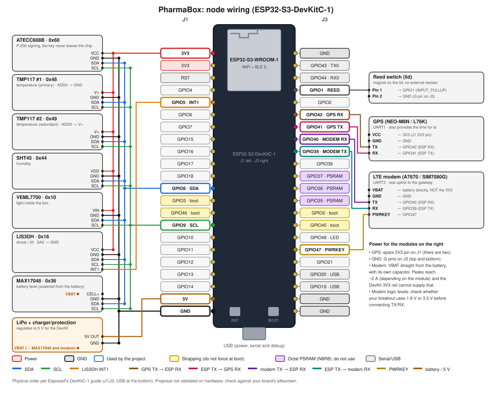
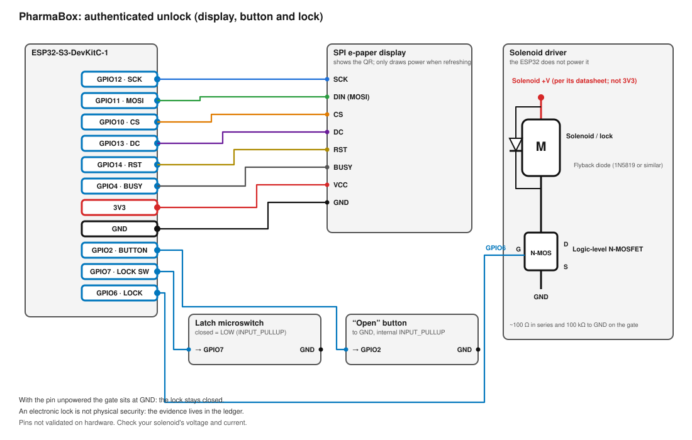

**English** · [Español](README.es.md)

# pharmatrace-firmware

Firmware for the **PharmaBox** node: the cold-chain case that safeguards the batches of
[Pharmatrace](https://github.com/gastonhp1/Pharmatrace). It measures the state of the cargo in transit, **signs every
reading** with a secure element and uploads it to the Pharmatrace gateway, which verifies it and anchors evidence in
the Hyperledger Fabric ledger.

The node does not talk to Fabric: only to the gateway (`backend/` in Pharmatrace). See [`docs/architecture.md`](docs/architecture.md) (in Spanish).

## Status

Skeleton. What is verified and what is not:

| | Status |
|---|---|
| Reading format v1 (21 bytes), unit conversion, ingest JSON builder, reading queue | **Tested on the host**: 17 tests, the official test vector from `READING_FORMAT.md`, 5000 random readings against an independent Python implementation, and the gateway's real `ingest.js` accepting the JSON this firmware builds |
| `src/main.cpp`, `uplink_wifi.cpp` (Arduino/ESP32) | Written, **not compiled or tested on hardware** |
| Authenticated unlock, option A (token over BLE): token parsing and validation, nonce/QR, attempt lockout | **Tested on the host**: 14 tests, plus end-to-end runs where Python signs a token and the C++ code verifies it with the same mbedtls P-256 code the ESP32 uses (valid, wrong key, wrong box, wrong nonce, tampered token) |
| BLE service, e-paper, lock driver, button (`ble_unlock`, `lock`, `display`, `main.cpp`) | Written, **only syntax-checked against stubs; not compiled with the real libraries or tested on hardware**. The e-paper is a serial stub for now |
| Sensor drivers, cellular modem | TODO (`main.cpp` marks them) |
| Signing with the ATECC608B | TODO: `signer_atecc608.cpp` fails on purpose instead of returning a fake signature |
| Pins and wiring | Proposal, not validated on hardware |

## Contract with the gateway

Defined in [`iot/docs/READING_FORMAT.md`](https://github.com/gastonhp1/Pharmatrace/blob/main/iot/docs/READING_FORMAT.md) in Pharmatrace. If it changes there, it changes here.

- A reading is **21 bytes, big-endian**: `ts`, `seq`, `tempCenti`, `humCenti`, `flags`, `latE5`, `lonE5`.
- The device signs **SHA-256(payload)** with **ECDSA P-256**, as a raw 64-byte `r || s` signature (what the ATECC608B does natively).
- Readings are uploaded with `POST /api/iot/readings` `{ deviceId, readings: [{ payload, signature }] }`, hex-encoded. There is no API key: the gateway only accepts valid signatures from a registered device that is actively monitoring a cargo.

What the gateway requires and the firmware honours:

- `seq` and `ts` **strictly increasing** within a cargo. `seq` is reserved and persisted in NVS *before* it is used.
- At most **200 readings per request** (`UPLOAD_BATCH_MAX` = 50).
- It answers `200 { accepted, duplicates, rejected }`. An exact duplicate is not an error, so **retrying a batch is safe**.
- `409` if the box is not monitoring any cargo yet, `403` if it is not operational: in both cases the readings are kept.
- `SAMPLE_INTERVAL_S` (60) must match the gateway's `IOT_SAMPLE_SECONDS`, because the gateway counts the last reading of each window as one sampling period.

The firmware **does not judge** whether a temperature is in range: the policy (2–8 °C, excursion budget) lives in the ledger and is enforced by the chaincode.

## Hardware

Per Pharmatrace's [`iot/hardware/BOM.md`](https://github.com/gastonhp1/Pharmatrace/blob/main/iot/hardware/BOM.md): **ESP32-S3** (not the classic ESP32), 2 × TMP117, SHT45, VEML7700, LIS3DH, **ATECC608B**, MAX17048, GPS, LTE modem (A7670 or SIM7080G) a lid reed switch, and, for the authenticated unlock, an SPI e-paper display, a button and a solenoid lock (see [`docs/unlock-protocol.md`](docs/unlock-protocol.md), in Spanish).

## Wiring



Display, button and lock (teal pins above) in detail:



Pins are in [`include/config.h`](include/config.h), using ESP32-S3-DevKitC-1 numbering:

| Function | GPIO | Connects to |
|---|---|---|
| I2C SDA / SCL | 8 / 9 | TMP117 ×2, SHT45, VEML7700, LIS3DH, ATECC608B, MAX17048 |
| INT1 (shock) | 5 | LIS3DH |
| Lid reed | 1 | Reed switch to GND, with `INPUT_PULLUP` |
| UART1 GPS | 42 (RX) / 41 (TX) | GPS TX / RX |
| UART2 modem | 40 (RX) / 39 (TX) | Modem TX / RX |
| Modem PWRKEY | 47 | Modem |
| E-paper SPI (SCK / MOSI / CS / DC / RST / BUSY) | 12 / 11 / 10 / 13 / 14 / 4 | Display showing the unlock QR |
| Unlock button | 2 | Button to GND, with `INPUT_PULLUP` |
| Lock drive / latch sensor | 6 / 7 | MOSFET gate for the solenoid / latch microswitch |

Things to keep in mind:

- **The modem is not powered from the DevKit's 3V3.** It draws from the battery with its own capacitor: peaks reach ~2 A depending on the module.
- Check whether your modem breakout uses 1.8 V or 3.3 V logic levels.
- On octal PSRAM modules (N8R8) GPIO35–37 are unavailable; this map does not use them. GPIO0/3/45/46 are strapping pins and GPIO19/20 are the USB.
- GPIO39–42 are the pin-based JTAG pins; they work as plain GPIO as long as you debug over the S3's native USB.
- GPIO1 and GPIO5 are RTC GPIOs: they can wake the device from deep sleep.
- Pin order comes from Espressif's DevKitC-1 user guide. Check it against your board's silkscreen before soldering.
- I2C addresses: TMP117 #1 uses `ADD0 → GND` (0x48) and #2 uses `ADD0 → V+` (0x49); the LIS3DH uses `SA0 → GND` (0x18). The MAX17048 is powered from the battery, not from 3V3.

## Layout

```
include/config.h               Pins, intervals and sizes
include/secrets.example.h      Template for DEVICE_ID, gateway and WiFi (secrets.h is not versioned)
lib/pharma_proto/              Protocol code with no Arduino dependency (tested on the host)
  pharma_reading.*               21-byte format, conversions, hex
  pharma_ingest.*                Body of POST /api/iot/readings
  pharma_queue.h                 Queue of signed readings waiting to upload
  pharma_unlock.*                Unlock token, QR text, challenge/attempt session
src/main.cpp                   Loop: sense → sign → enqueue → upload
src/signer*.{h,cpp}            Signing interface + ATECC608B skeleton
src/verifier_mbedtls.*         P-256 verification of the unlock token
src/ble_unlock.*, lock.*, display*   BLE service, solenoid lock, display (serial stub)
tools/unlock_token.py          Generates a test key and signs unlock tokens
src/uplink*.{h,cpp}            Transport interface + WiFi for bench testing
test/test_proto/               Protocol tests, including the official vector
test/test_unlock/              Unlock token/session tests
tools/e2e_unlock.cpp           Host program: verifies a token signed by tools/unlock_token.py
docs/unlock-protocol.md        Authenticated unlock protocol (Spanish)
docs/architecture.md           How it fits with the gateway and Fabric (Spanish)
docs/wiring.{en,es}.svg        Wiring diagram
```

## Tests and build

```bash
pip install platformio
pio test -e native              # protocol, on the host (no hardware)

cp include/secrets.example.h include/secrets.h    # fill in DEVICE_ID, GATEWAY_URL, WiFi
cp include/unlock_key.example.h include/unlock_key.h   # the backend's unlock PUBLIC key
pio run                         # build for ESP32-S3
pio run -t upload && pio device monitor
```

To exercise the gateway without hardware, Pharmatrace ships a virtual box in `iot/simulator/` that generates signed
readings in the same format.

## To do

- **ATECC608B:** provision it (generate the P-256 key on the chip, read only the public key, lock configuration and data) and implement `Atecc608Signer`. The public key printed at boot is the one to register with `POST /api/iot/devices`.
- **Secure boot and flash encryption** on the ESP32-S3 before handing a box over.
- **Drivers** for TMP117, SHT45, LIS3DH, VEML7700, MAX17048, GPS and the modem (with TLS).
- **Persist the queue to flash** (LittleFS): it lives in RAM today and is lost on reboot. When it fills up it drops the oldest reading, leaving a `seq` gap.
- **Deep sleep** with wake-up on the reed switch and the accelerometer, for battery life.
- **Two ways format v1 falls short** (it has to change in all three repos at once):
  - It has a single temperature field, but the BOM includes two TMP117s to detect failures or tampering. We still need to decide what to report and how to flag a disagreement (bits 5–7 of `flags` are free; 0x08 and 0x10 are proposed for unlock events).
  - There is no "valid GPS fix" bit: without a fix the last known position is reused.
- **Time:** without a valid time (GPS or a synced RTC) nothing is emitted.

## Relationship with Pharmatrace

[Pharmatrace](https://github.com/gastonhp1/Pharmatrace) is now the **Hyperledger Fabric** version: Go chaincode, a local 4-organization network, an Express API on top of the Fabric Gateway, and the `iot/` folder. The Solidity/Hardhat version lives in [Pharmatrace-evm](https://github.com/gastonhp1/Pharmatrace-evm). This repo is separate because the firmware's build, flashing and versioning cycle is independent.
